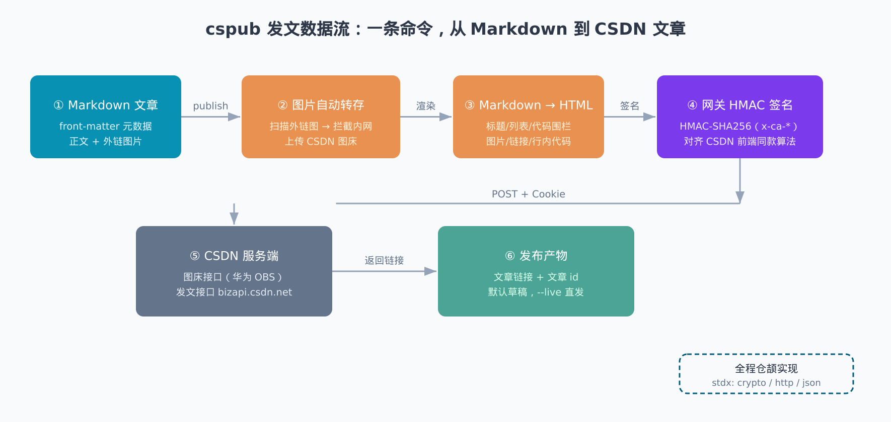
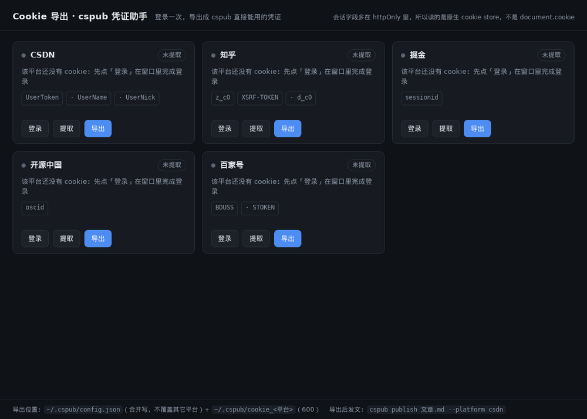

<div align="center">

# cspub

**多平台文章发布助手 —— 用华为仓颉语言实现**

一份 Markdown（带 front-matter），一条命令发到多个平台：CSDN / 知乎 / 百家号 / 博客园 / 掘金 / 开源中国 / 腾讯云开发者社区 / 语雀 / 头条号 / SegmentFault 思否，自动签名/登录、自动转存图片、默认发草稿。

🌐 **官网** <https://yangyongzhen.github.io/cspub/> —— 平台矩阵、流水线、图片转存策略与实测数据都在那；静态站零第三方依赖（含源码 `website/`）。

> 国内 AtomGit 托管：[atomgit.com/qq8864/cspub](https://atomgit.com/qq8864/cspub)，与 GitHub 镜像同步更新（同一提交双端推送，ref 一致）。

[](https://cangjie-lang.cn)
[](./LICENSE)
[](#已知限制)
[](https://yangyongzhen.github.io/cspub/)
[](https://github.com/yangyongzhen/cspub)
[](https://atomgit.com/qq8864/cspub)

</div>

```bash
cspub publish 我的文章.md --platform csdn       # CSDN（Cookie + 网关签名，默认发草稿）
cspub publish 我的文章.md --platform zhihu      # 知乎专栏（Cookie 登录态，图片自动转存知乎 CDN）
cspub publish 我的文章.md --platform baijiahao  # 百家号（Cookie 浏览器通道 / 开发者凭证）
cspub publish 我的文章.md --platform cnblogs    # 博客园（官方 MetaWeblog API，纯 HTTP）
cspub publish 我的文章.md --platform juejin     # 掘金（Cookie 两步流；图片外链优先，AtomGit 图床）
cspub publish 我的文章.md --platform oschina    # 开源中国（Cookie 直通站点接口；图片走它自带图床）
cspub publish 我的文章.md --platform tencent    # 腾讯云开发者社区（Cookie 零签名；--draft 真存草稿，回显 draftId）
cspub publish 我的文章.md --platform yuque      # 语雀（官方 OpenAPI v2 + Token；--draft 建成私密文档）
cspub publish 我的文章.md --platform toutiao    # 头条号（Cookie + X-CSRFToken；图片必须全转存头条 CDN）
cspub publish 我的文章.md --platform segmentfault  # SegmentFault 思否（Cookie + 页面取 Token；--draft 存草稿箱）
cspub publish 我的文章.md --live                # 直接发布
```

## 它做什么

1. 读 Markdown + front-matter（title / tags / categories / desc / draft / origin_url）；
2. **按平台自动转存图片**：CSDN 外链图转 CSDN 图床（防盗链），知乎图转知乎 CDN（知乎剥离站外图）；
3. 把 Markdown 渲染成 HTML（各平台编辑器都要求发渲染后的 HTML，不是 Markdown 源文）；
4. 按平台鉴权发文：CSDN 走网关 HMAC-SHA256 签名（`x-ca-*`）+ Cookie；知乎走 Cookie 草稿接口三步流；百家号走 Cookie 浏览器自动化（Playwright 伴生脚本）或官方开发者凭证；腾讯云开发者社区走编辑器自身的 RPC `column/article`（纯 Cookie、零签名）；语雀走官方 OpenAPI v2（`X-Auth-Token`，Markdown 原样提交）；头条号模拟后台 `mp/agw` 接口（Cookie + `X-CSRFToken`）；SegmentFault 走 `/gateway` 网关（Cookie + 从写文章页实时取的 `Token`，双头同值）；
5. 回显文章链接与 id（CSDN 支持更新用 `--update <id>`）。

主链路全部用仓颉标准库 + stdx 实现（HMAC / Base64 / HTTP / JSON），零第三方依赖；仅百家号 Cookie 通道需要一个 Playwright 伴生脚本。

## 发文数据流

一条命令背后是六环节流水线，全部自动完成：



> 源图 `docs/imgs/cspub-flow.svg`（可编辑）。第②步"图片自动转存"的防线细节见下文「图片转存」一节。

## 为什么是仓颉

这是个真实场景练手项目：华为仓颉的 stdx 恰好齐活一条「HTTP 客户端 + HMAC 签名 + JSON」链路，
够写一个正经的 CLI 工具。实现过程的坑（HMAC 对账、TLS 信任、UTF-8 字节语义、struct 可变性）
都记录在文末「实现要点」里，对写仓颉网络程序有直接参考价值。

## 为什么自己写

CSDN 的编辑器接口（`bizapi.csdn.net/blog-console-api/v3/mdeditor/saveArticle`）走**阿里云 API 网关风格的 HMAC-SHA256 签名**（`x-ca-*` 请求头），key/secret 烙在 CSDN 公开的前端 JS 里；账号凭据只需要你自己的登录 Cookie。整个工具就是：读文件 → 解析 front-matter → Markdown 渲染成 HTML → 签名 → POST。仓颉 1.2.0 的 stdx（`stdx.crypto.digest` HMAC、`stdx.encoding.base64`、`stdx.net.http`）恰好齐活，不用任何外部依赖。

## 构建

```bash
export CANGJIE_STDX=<stdx>/dynamic/stdx      # 1.2.0 配套的 stdx
export PATH=$CANGJIE_HOME/bin:$CANGJIE_HOME/tools/bin:$PATH
cjpm build
# 产物：target/release/bin/main
# Windows 交叉编译：./scripts/winbuild.sh（方案沿用 cjh，产出 exe + 自包含 zip）
```

## 配置凭证（各平台二选一）

### 用 cookie-export 自助提取（推荐，免 F12 手抄）



登录态里最关键的那几个字段——知乎 `z_c0`、掘金 `sessionid`、CSDN `UserToken`——多半是 **httpOnly**，`document.cookie` 读不到，F12 手抄还容易漏字段、漏整串。`cj-tauri` 仓库里的 [`examples/cookie-export`](https://atomgit.com/qq8864/cj-tauri/tree/main/examples/cookie-export) 就是为这件事写的桌面小工具：内嵌浏览器登录一次，点三下拿到 cspub 直接能用的凭证。

1. **登录**：点平台卡片的「登录」，在内嵌窗口里正常登录（与浏览器同源，共享 cookie store）；
2. **提取**：点「提取」，按 cspub 各平台的字段硬需求逐项校验，缺哪个字段直接点出来（例如 `已提取，但缺必需字段：UserToken`）；
3. **导出**：点「导出」，写 `~/.cspub/config.json`（**合并写**，不覆盖其他平台已有凭证；`chmod 600`）＋ `~/.cspub/cookie_<平台>` 文本文件（沿用 F12 手抄时的习惯）。

- 覆盖平台（9 家）：CSDN / 知乎 / 掘金 / 开源中国 / 百家号 / 腾讯云开发者社区 / 头条号 / 小红书 / 语雀；博客园走 MetaWeblog 令牌（不是 cookie），工具里只做引导。**SegmentFault 不收录**：它的发文 token 是页面 HTML 里临时抓的（`__NEXT_DATA__` 的 `serverData.Token`），没有固定 cookie 字段可校验，硬编字段只会误导。
  （cspub 本身**支持** SegmentFault——它只需要一整串 Cookie，token 由 cspub 在发文时自己取；cookie-export 是逐字段提取工具，摘不出「整串」这种形态，所以不收录。51CTO 见 `docs/多平台发文调研.md` §十：登录前拿不到发文请求体，暂不支持。）
- 全部在本机运行，不上报任何 cookie；构建需仓颉 SDK（Linux 走 WebKitGTK、Windows 走 WebView2）。
- 下表「获取方式」列照旧可用——工具是省事路径，不是唯一路径。

| 平台 | 环境变量 | config.json 字段 | 获取方式 |
| --- | --- | --- | --- |
| csdn | `CSPUB_CSDN_COOKIE` | `csdnCookie` | 浏览器登录 → F12 → 复制 Cookie 整串 |
| zhihu | `CSPUB_ZHIHU_COOKIE` | `zhihuCookie` | 登录 zhuanlan.zhihu.com → F12 → 复制 Cookie 整串（须含 `z_c0`） |
| baijiahao | `CSPUB_BAIJIAHAO_COOKIE`（通用）或 `CSPUB_BAIJIAHAO_APP_ID` / `CSPUB_BAIJIAHAO_APP_TOKEN` | `baijiahaoCookie` 或 `baijiahaoAppId` / `baijiahaoAppToken` | ①Cookie：登录 baijiahao.baidu.com → F12 → 复制整串（须含 `BDUSS`）②开发者：后台「开发 → 基本配置」（现为定向邀请制，有入口才可用） |
| cnblogs | `CSPUB_CNBLOGS_BLOG_ID` / `CSPUB_CNBLOGS_USERNAME` / `CSPUB_CNBLOGS_TOKEN` | `cnblogsBlogId` / `cnblogsUsername` / `cnblogsToken` | 后台设置 → 开启「允许博客客户端访问」→ 复制 MetaWeblog 访问地址尾巴（博客名）、登录名与访问令牌（**非登录密码**） |
| juejin | `CSPUB_JUEJIN_COOKIE`（+ 可选 `CSPUB_JUEJIN_UUID/CATEGORY_ID/TAG_IDS`） | `juejinCookie` 等 | 登录 juejin.cn → F12 → 复制 Cookie 整串（须含 `sessionid`）；分类/标签用后台抓包的内部 ID（可选）。正文图片**外链优先**：配了 `CSPUB_ATOMGIT_TOKEN` 就走 AtomGit 图床，否则降级浏览器通道（需 `pip install playwright && playwright install chromium`） |
| oschina | `CSPUB_OSCHINA_COOKIE`（+ 可选 `CSPUB_OSCHINA_USER_ID/CATALOG/PRIVACY`） | `oschinaCookie` 等 | 登录 oschina.net → F12 → 复制 Cookie 整串（须含 `oscid`）。**图片直接用它自带图床**（`oscimg.oschina.net`），无需额外配置；分类默认按 front-matter `categories` 名匹配，匹配不到取账号第一个分类 |
| tencent | `CSPUB_TENCENT_COOKIE`（+ `CSPUB_TENCENT_TAG_IDS`，可选 `CSPUB_TENCENT_CLASSIFY_IDS`） | `tencentCookie` / `tencentTagIds` / `tencentClassifyIds` | 登录 cloud.tencent.com → F12 → 复制 Cookie 整串（须含 `skey` 或 `qcommunity_session`；`skey` 里的 `*` 原样保留，**不要 URL 编码**）。**`tencentTagIds` 必填**（逗号分隔的数字 id，空则接口回 `-9993 请选择文章标签`，工具会本地先拦下）；专栏必须是自己**已加入**的（拿后台专栏 id 填 `tencentClassifyIds`，填别人/默认 149 会回 `300031 user not the column member`）。正文纯文本不少于 140 字 |
| yuque | `CSPUB_YUQUE_TOKEN` + `CSPUB_YUQUE_NAMESPACE`（+ 可选 `CSPUB_YUQUE_PUBLIC`） | `yuqueToken` / `yuqueNamespace` / `yuquePublic` | 官方 OpenAPI v2：去 <https://www.yuque.com/settings/tokens> 生成 Token，namespace 取知识库 URL 的两段（`user/repo`，**单段一定 404**）。`public` 不配则继承知识库公开性；`--draft` 建成 `public=0` 私密文档 |
| toutiao | `CSPUB_TOUTIAO_COOKIE`（+ 可选 `CSPUB_TOUTIAO_CSRF`） | `toutiaoCookie` / `toutiaoCsrf` | 登录 mp.toutiao.com → F12 → 复制 Cookie 整串（须含 `sessionid` 或 `tt_webid`）。`X-CSRFToken` 默认自动取 cookie 里的 `csrftoken`，取不到才需要显式给 `CSPUB_TOUTIAO_CSRF`。**标题 5~30 字**；**正文每张图都必须转存头条 CDN**——任何非头条域名图片会让整篇被拒（`7115 图片uri非法`），所以头条是唯一「外链也强制转存」的平台 |
| segmentfault | `CSPUB_SEGMENTFAULT_COOKIE` | `segmentfaultCookie` | 登录 segmentfault.com → F12 → 复制 Cookie **整串**（思否没有可自查的登录 cookie 字段，登录态由发文时取到的 Token 判定）。走 `/gateway` 网关，`Token` 与 `Authorization: Bearer` 双头同值，Token 从写文章页 `__NEXT_DATA__` 实时取，无需手工填。`--draft` 存草稿箱、`--live` 直接发布。正文图片需公网 URL（配 `CSPUB_ATOMGIT_TOKEN` 自动转外链） |
| 掘金图片（可选） | `CSPUB_ATOMGIT_TOKEN`（+ `CSPUB_ATOMGIT_REPO/BRANCH/DIR`） | `atomgitToken` 等 | AtomGit 个人访问令牌；默认仓库 `qq8864/images`、分支 `main`、目录 `cspub`。配了它本地图上传图床、正文嵌 raw 外链，不依赖浏览器 |
| 图片门禁（可选） | `CSPUB_STRICT_IMAGES` | — | 设 `1/true/yes` 时，转存后正文仍有本地图片未转存就**中止发布**（返回码 1）；默认不设＝best-effort，只打 `⚠⚠` 告警照发 |
| 伴生脚本目录（可选） | `CSPUB_SCRIPT_DIR` | — | 百家号/掘金的 `scripts/*.py` 查找根。不设时依次找：当前工作目录 → 可执行文件目录向上回溯 5 级，所以**不再要求必须在仓库根目录运行** |

配置文件：`~/.cspub/config.json`（`chmod 600`），例：
`{"csdnCookie": "...", "zhihuCookie": "...", "baijiahaoCookie": "..."}`

### 环境变量方式（推荐，不落盘）

环境变量与 config.json 二选一即可；**环境变量优先**——同时配置时以环境变量为准（临时换号/测试时不必改配置文件）。

**临时生效**（当前终端会话，关闭即失效）：

```bash
export CSPUB_CSDN_COOKIE='<浏览器 F12 复制的 Cookie 整串>'
cspub publish 我的文章.md --live
```

**持久生效**（写进 shell profile，每次新开终端自动带上）：

```bash
# ~/.bashrc（zsh 用户写 ~/.zshrc）
echo "export CSPUB_CSDN_COOKIE='<Cookie 整串>'" >> ~/.bashrc
source ~/.bashrc

# 多平台就各写一行
echo "export CSPUB_ZHIHU_COOKIE='<Cookie 整串>'" >> ~/.bashrc
```

> Cookie 整串含空格与分号，写 profile 时务必用单引号包裹（单引号内 shell 不展开，原样存为变量值）；
> Cookie 过期后重取整串，`sed -i` 定向替换旧行或重新 `echo >>` 即可。

**安全提示**：环境变量对同机其他进程可见（`/proc/<pid>/environ`），共享机器建议改用 config.json + `chmod 600`；个人机器两者皆可。

> 百家号双通道：纯 Cookie 直调其发布接口不可行（React 发布按钮需完整事件链，直调 API 缺 CSRF 必 500），所以 **Cookie 通道走浏览器自动化**——`--platform baijiahao` 自动调起 `scripts/baijiahao_publish.py`（Playwright 填表单 + 点发布），宿主机需 `pip install playwright && playwright install chromium`；配置了开发者凭证则优先走官方 token 接口。

`cspub whoami [平台名]` 校验凭证是否就位（只验格式不联网；`yuque` 与 `segmentfault` 例外，会真发一次请求验证登录态）。

## 用法

```
cspub check   <文章.md>            解析 front-matter + 渲染统计（不联网）
cspub html    <文章.md>            打印渲染后的 HTML（调试用）
cspub imgs    <文章.md>            预演图片去向（rehost / skip / BLOCKED，不联网）
cspub publish <文章.md> [--draft]  发草稿（默认）
                   [--live]        直接发布（覆盖 front-matter 的 draft: true）
                   [--platform p]  目标平台，缺省 csdn（见顶部平台清单）
                   [--update <id>] 原地更新指定文章（仅 CSDN）
                   [--insecure]    跳过 TLS 证书校验（TrustAll，仅诊断/自担风险）
cspub whoami  [平台名]             校验平台凭证配置
cspub help
```

环境变量 `CSPUB_DEBUG=1`：往 stderr 打图床/发文链路的诊断行（请求体积、OBS 状态码与响应首段），
排查上传异常时用；正常使用无需设置。

## 图片转存（publish 自动做）

各平台策略不同，`publish` 会按 `--platform` 自动选择：**CSDN / 知乎 / 头条号 / 腾讯云**必须转到平台自己的图床
（前三家会剥站外图或直接拒稿），**掘金 / SegmentFault** 接受外链（配了 `CSPUB_ATOMGIT_TOKEN` 就转 AtomGit 图床），
**开源中国**用它自带图床。共性底线不变：拦内网/回环地址、拒绝 30x 重定向、单张限 12 MiB、单张失败保留原链接
不阻断发文。下面是 CSDN 这条最复杂的链路：

CSDN 对站外图有防盗链（典型形状：`` 直连返回 **HTTP 200 + 0 字节**）。`publish` 在发文前**自动**把
站外图转存到 CSDN 图床（csdnimg.cn）并回写 URL：

1. 扫描正文图片引用（代码围栏内跳过）；
2. 分流：已是 CSDN 图床 / `data:` 的跳过；内网、回环、链路本地等非公网地址**拦截**（防把本机内网服务当图源）；
3. 下载（**拒绝 30x 重定向**——重定向可能把请求带到没检查过的主机；单张上限 12 MiB）；
4. CSDN 图床签名接口（网关 HMAC + Cookie）→ 华为 OBS multipart（policy 授权）→ 回调返回 csdnimg.cn URL；
5. 从后往前回写 Markdown（偏移不挪位）；**best-effort**：单张失败保留原链接并提示，不阻断发文。

发文前可先 `cspub imgs <文章.md>` 预演：只扫描不联网，列出每张图会被如何处理（rehost / skip / BLOCKED）。

**已验证（2026-10-21）**：一篇带 2 张 `raw.githubusercontent.com` 外链图的真实文章，转存 2/2 成功，
回写后的链接形如 `https://i-blog.csdnimg.cn/direct/<hash>.png`，发文后正文图片正常显示。

**这条链路的坑（值得记一笔）**：图床签名响应里 `customParam.isAudit` 是 **JSON 数字**，用只认字符串的
`jsonStr` 去取会得空串；把空的 `x:isAudit` 发给华为 OBS，OBS 回的是 **HTTP 200 + 0 字节**——看起来像
"被网关吞了"，实际是回调拿不到字段。改法是 `jsonScalar`：按 JsonKind 分别取字符串/数字/布尔字面量。

### 掘金：外链优先（AtomGit 图床）

掘金**接受外链图片**（实测 API 建草稿后外链图 `naturalWidth>0`，示例文章
[juejin.cn/post/7704394460696461350](https://juejin.cn/post/7704394460696461350) 正文图片就全在 AtomGit 仓库上），
所以不必把图搬进掘金图床。配了 `CSPUB_ATOMGIT_TOKEN` 时，`--platform juejin` 的图片走：

1. 本地图逐张 `POST` 到 AtomGit 仓库 `contents` 接口（base64 内容 + 提交说明 + 分支）；
2. 正文回写 `https://atomgit.com/api/v5/repos/<owner>/<repo>/raw/<path>?ref=<branch>`；
3. 已是 `http(s):` 的外链原样保留；上传失败的图降级浏览器通道（`scripts/juejin_upload.py`）→ 内置 ImageX
   → 都失败则保留原引用并提示，**不阻断发文**。

好处是整条图片链路不再依赖 `python3 + playwright + chromium`。外链地址匿名可直取（实测 `HTTP 200` + `image/jpeg`）。

### 开源中国：先用它自带图床

开源中国浏览器编辑器上传图片走 `POST /oschinapi/upload/img`（multipart 字段 `file`，**只要登录 Cookie**），
返回 `https://oscimg.oschina.net/.../up-<md5>.png` 直链，实测 2MB 图片单请求即可（分片接口 `upload/init` 是给大文件用的）。
所以 `--platform oschina` 的图片优先级是：

1. 平台自带图床（无需额外配置，有 Cookie 就行）；
2. 失败的本地图再用 AtomGit 外链兜底（配了 `CSPUB_ATOMGIT_TOKEN` 才启用）；
3. 仍失败保留原引用并提示，**不阻断发文**。

> 直链里夹着 `//null/` 一段（服务端未用的桶位），链接本身有效：浏览器 UA 取回 `HTTP 200` 且字节与源图一致；
> 裸 `curl` 无 UA 会被 CDN 403（146 字节 `TLB` 页），别据此误判成死链。

### 开源中国：正式发布的三个实测特性

真机跑过一篇（cj-tauri 观影应用实战，3 张本地图），结论如下，**发之前值得知道**：

1. **正文提交 Markdown，服务端存 HTML**：请求体 `contentType: 1` + 原始 Markdown，但 `blog/detail` 回读到的
   `content` 已经是 `<h2>/<p>` 渲染结果——不要自己预渲染 HTML，会双重转换。
2. **tags 由平台自动提取**：front-matter 里写的标签不生效，服务端按正文关键词自己抽
   （实测被抽成 `tauri,json,https,examples,image,...`）。分类则尊重 `catalog`（按名字匹配或取第一个）。
3. **文章 URL 是 `/blog/{id}`**，不是 `/u/{userId}/blog/{id}`（后者服务端直接 404）。但注意 SPA 外壳：
   该路由对**不存在的 id 也回 200 + 同一个 3730 字节外壳**，所以 `curl` 状态码**不能**用来判断文章是否可见。
   判活必须浏览器渲染（看 h1/正文长度）或查询 `blog/detail` 接口。

> ⚠️ **发布成功 ≠ 立刻公开**：实测发布接口返回博客 id 后，`blog/detail` 能读到完整正文与图片，但公开页面
> 渲染为「找不到您访问的页面」。新号/首篇大概率走**人工审核**，请过一段时间再确认；不要因为接口回了 id
> 就认定已经上线。

## front-matter

```markdown
---
title: 文章标题            # 必填
tags: 仓颉, 工具           # 逗号/顿号分隔，最多 5 个（API 上限）
categories: 编程
desc: 摘要一行             # 缺省从正文剥 Markdown 取前 200 字
draft: true                # 缺省 true；publish 时 --live 可覆盖
---

正文 Markdown……
```

## 实现要点（也是坑）

- **content 必须是渲染后的 HTML**：直接发 Markdown 原文，CSDN 页面显示字面 `##` 与 ``。
  内置了一个**够用即可**的 Markdown → HTML 渲染器（标题/段落/列表/引用/代码围栏/图片/链接/行内代码/加粗），
  复杂排版（表格、脚注）未覆盖——要用就先 `cspub html` 目验。
- **HMAC 对账**：签名实现用 Python `hmac+sha256` 逐字节对过账；nonce 用随机 16 字节 hex（`std.random.nextBytes`）。
- **UTF-8 安全**：摘要截断按首字节判界（`(b & 0xC0) != 0x80`），不在汉字中间切开；行内渲染按区间整体转码，
  不逐字节 append（逐字节会把汉字拆成非法序列）。
- **外链图必须先转存**：CSDN 对站外图有防盗链（典型形状 200 + 0 字节）；`publish` 已内置自动转存
  （见「图片转存」一节），2026-10-21 用真实文章端到端验证通过。
- **Cookie 会过期**：401/403 时工具会提示重取；WAF 若拦截（403 + HTML），换网络/重新过验证码再试。
- **TLS 信任的已知问题**：CSDN 的证书链根是 Certum（小众 CA），实测本机 stdx TLS（1.0.5.1 与 1.2.0.1
  两代）默认模式与 CustomCA 模式（内嵌逐字节一致的 Certum 根）都报 unknown CA，而系统 curl 验同一条链
  通过——疑 stdx 动态加载的 OpenSSL 验证行为问题（已记录待查）。`--insecure`（TrustAll）是逃生口：
  探针已用它验证签名/请求形状可过网关（401 = 只缺登录 Cookie）。正式发文先试默认模式，失败再加
  `--insecure`（HTTPS 内容仍加密，只是不验服务器身份，风险自担）。
- **stdx 1.2.0 的编译差异**：`CertificateVerifyMode` 已移到 `stdx.net.tls.common` 子包，需显式
  `import stdx.net.tls.common.*`、变体写限定名（`CertificateVerifyMode.TrustAll` / `CertificateVerifyMode.CustomCA`）；
  且 `CustomCA` 收的是 `Array<Certificate>`（接口），而 `X509Certificate.decodeFromPem` 返回
  `Array<X509Certificate>`（类）——Array 不协变，得显式搬一次。源码以 1.2.0 为准，1.0.5.1 下这几处编译不过。

## 版本维护

- **版本号**：`cjpm.toml` 的 `version` 字段是单一真相；发版时同步更新 `CHANGELOG.md`，规则沿用 cjh——重大更新递增中间位、小更新递增末位。
- **变更记录**：`CHANGELOG.md` 按 Keep a Changelog 风格维护（新增 / 变更 / 修复 / 文档 / 构建 分节），每条带验证证据（实测输出、错误码、转存结果），不写没有证据的条目。
- **仓库与远程（双远程）**：源仓在 [AtomGit](https://atomgit.com/qq8864/cspub)（`origin`），
  [GitHub](https://github.com/yangyongzhen/cspub) 是镜像（`github`）。发版时两边都推：
  `git push origin main && git push github main`。注意本机 git 配置了
  `url.https://ghfast.top/https://github.com/.insteadof https://github.com/`，推 GitHub 实际走镜像加速，
  `git remote -v` 里显示的也是加速地址，属正常。
- **发布流程**：`cjpm build` → 产物入 `dist/`（tar.gz + SHA256SUMS）→ 打 tag（`v0.1.0` 格式）→ 基于 tag 发 release 并附产物。详见 `docs/发布与版本维护.md`。
- **开发规范**：见 [AGENTS.md](./AGENTS.md)——变更交付门禁、代码组织原则、踩坑沉淀与文档规范。

## 已知限制

- 表格 / 脚注 / 任务列表等扩展 Markdown 不渲染（原样进段落）；
- 更新文章只支持 `--update <id>`（id 在首次发布成功后回显）；
- **开源中国公开可见性**：发布接口回了博客 id 也不代表立刻公开（新号/首篇走人工审核），公开页可能仍是
  「找不到您访问的页面」；判可见性只能靠浏览器渲染，`curl` 该路由一律 200 无信息量；
- **Windows 侧**：`./scripts/winbuild.sh` 交叉编译产出 exe（8.2 MB，mingw strip 后）+ 自包含 zip（exe + libboundscheck / libcangjie-runtime / libcrypto-3-x64 / libssl-3-x64 四 DLL，解压同目录即用）；发文链路未在真机 Windows 实测；
- **CSDN 每日发文限额**：实测该账号每天只能发 1 篇，额度用满时 `saveArticle` 直接回
  `{"code":400300012,"msg":"今天发表文章数量已达到限制的1篇。"}`；存草稿（`status=2` / `pubStatus=draft`）
  同样被拒（错误码 400300001）——这不是工具问题，换自然日或换账号即可；
- 上传/发文链路已端到端跑通（2026-10-21）：图片转存 2/2、发文成功回显 article id、`--update <id>` 原地更新可用。
